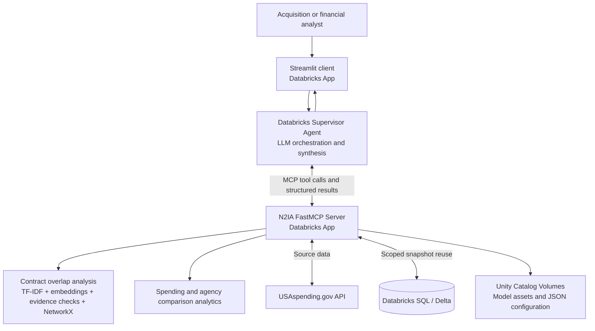

# N2IA Federal Spending Intelligence

**MCP Server + Databricks Supervisor Agent | GSA MCP Server & AI Agent Government Hackathon**

Federal agencies spend billions of dollars on technology and support-service contracts. Seeing the full picture is difficult: awards are distributed across agencies and vendors, descriptions use different terminology, and spending figures alone do not explain whether requirements are related or where further acquisition review may be useful.

**What if an analyst could simply ask:** *“Are we buying similar services in multiple places, how does our spending compare with other agencies, and where should we look more closely?”*

**N2IA Federal Spending Intelligence** is an AI-enabled application that helps federal acquisition and financial-management professionals explore those questions using public federal contract data. It combines source-backed retrieval, spending analytics, hybrid contract-similarity detection, and agent-based orchestration to produce explainable findings with supporting evidence.

> **Important:** Related contract scopes are **candidates for human acquisition review**, not proof of duplicate spending, waste, consolidation opportunities, or savings. Spending differences do not, by themselves, establish inefficiency.

## What the solution does

An analyst selects agencies, fiscal years, and IT service categories in a Streamlit application. The application submits requests to a Databricks Supervisor Agent, which invokes tools exposed by the N2IA MCP Server. Results are returned as summaries, comparisons, contract-level evidence, visualizations, and conversational explanations.

The solution supports two complementary lines of analysis:

- **Contract relationship discovery:** Identify contracts with potentially related requirements using lexical and semantic similarity, procurement-specific evidence, and performance-period context. Present preliminary candidate pairs and qualified relationship groups for further review.
- **Spending intelligence:** Compare IT spending and obligation trends, acquisition patterns, and vendor concentration across selected agencies and periods. Interpret differences in light of mission and scope limitations.

The application uses configurable agency and service-category selections rather than hard-coded analysis options. GSA and DHS cybersecurity contracts in FY2025 provide one demonstration scenario, not a restriction on the architecture.

## Solution architecture

**Clear separation of responsibilities:**

| Component | Responsibility |
| --- | --- |
| **Streamlit client** | Guided analysis, filters, tables, visualizations, source evidence, and follow-up chat. |
| **Databricks Supervisor Agent** | Interprets requests, selects MCP tools, and synthesizes their results using a Databricks-hosted model endpoint. |
| **N2IA FastMCP Server** | Retrieves data and executes deterministic analytics, similarity scoring, qualification rules, relationship grouping, and spending comparisons. |
| **USAspending.gov** | Public federal contract-award and spending data. |
| **Databricks SQL / Delta** | Scoped, reusable snapshots of bounded contract searches. |
| **Unity Catalog Volumes** | Reusable Hugging Face model files and JSON configuration assets. |

The LLM **does not calculate contract similarity scores**. Those calculations run in the MCP server; the Supervisor Agent handles orchestration and explanation.

## How contract relationship discovery works

1. **Retrieve and prepare awards.** Query bounded USAspending.gov award sets for selected agencies, fiscal years, and service categories. Deduplicate records and inspect descriptions, identifiers, classifications, and performance dates.
2. **Identify preliminary candidates.** Use two complementary approaches:
   - **Lexical similarity:** scikit-learn TF-IDF cosine similarity, with a screening threshold of **0.20** and at least **two shared informative terms**.
   - **Semantic similarity:** Hugging Face `sentence-transformers/all-MiniLM-L6-v2` embeddings and cosine similarity, with a screening threshold of **0.55**.
3. **Qualify relationships.** Examine shared service functions, specific terminology, PSC/NAICS context, and relevant performance-period overlap. Apply cross-agency restrictions when requested. A similarity score or matching classification alone is insufficient to establish equivalent scope.
4. **Build reviewable groups.** Represent qualified relationships as edges in a **NetworkX** graph and identify connected components. A group indicates connected evidence-backed relationships; it does **not** mean every pair of contracts in that group is equivalent.
5. **Present the evidence.** Return candidate relationships, qualified groups, source award details, screening indicators, and limitations for analyst review.

The thresholds were refined through iterative analysis of real contract records. They are **screening settings, not calibrated probabilities or measures of accuracy**. Qualifying evidence can include more than one signal; the semantic threshold is not necessarily a mandatory minimum for every final group.

## MCP design decisions

| Decision | Why it matters |
| --- | --- |
| **MCP-first analytical tools** | Reusable capabilities can be discovered and invoked by an agent without embedding analysis logic in the UI or prompt. |
| **Separation of orchestration and calculation** | The Supervisor Agent explains results; FastMCP retrieves and analyzes the underlying data. |
| **Source-backed analysis** | Contract facts and identifiers come from USAspending.gov, not LLM-generated records. |
| **Hybrid lexical and semantic matching** | Combines distinctive shared terminology with conceptually related descriptions. |
| **Procurement-aware evidence checks** | Adds service-function and contract context beyond text similarity alone. |
| **Graph-based relationship grouping** | Makes multiple connected contract relationships easier to review while preserving pair-level evidence. |
| **Caching and reusable model assets** | Reduces avoidable API retrieval and repeated model downloads when reusable assets or valid snapshots are available. |
| **Human-in-the-loop interpretation** | Supports defensible acquisition review without making automated findings of duplication or savings. |

## Caching and configuration

For bounded contract searches, the MCP server checks for a **matching, reusable snapshot in Databricks SQL/Delta**. If a suitable snapshot is unavailable, it retrieves awards from USAspending.gov and can persist the results for later reuse. Reuse is tied to the search scope; the existence of a cached record does not imply comprehensive coverage.

The Hugging Face sentence-transformer model is stored in a **Unity Catalog Volume**, allowing the application to load locally available model assets instead of downloading the model on every deployment or execution. Agency and service-category options are also maintained in **JSON configuration stored in Unity Catalog Volumes**.

These are distinct optimizations: **Delta snapshots cache award searches; Unity Catalog Volumes hold model and configuration assets.** Broader persistent embedding reuse remains an enhancement opportunity, not a claimed fully implemented cache. Cache availability and observed performance can vary by query and execution.

## Technology stack

| Technology | Role |
| --- | --- |
| Databricks Apps | Hosting for the Streamlit client and FastMCP server |
| Databricks Supervisor Agent / Model Serving | LLM orchestration, tool selection, and response synthesis |
| FastMCP / Python | Agent-accessible analytical tools |
| USAspending.gov API | Public award and spending records |
| scikit-learn | TF-IDF vectorization and lexical cosine similarity |
| Hugging Face Sentence Transformers | Semantic embeddings (`all-MiniLM-L6-v2`) |
| NetworkX | Relationship grouping |
| Databricks SQL / Delta | Bounded award-search snapshots |
| Unity Catalog Volumes | Model files and JSON configuration |
| Streamlit | Interactive user interface and visual analytics |

## Example: FY2025 cybersecurity review

A demonstration analysis compares cybersecurity-related awards involving **GSA and DHS**. The workflow surfaces preliminary relationships and qualified groups for further investigation, including service areas such as cybersecurity subject-matter support, architecture and engineering, and Risk Management Framework support.

Analysts can inspect the underlying contract descriptions, classifications, dates, and relationship evidence before deciding whether any further procurement investigation is warranted. Even highly similar descriptions may represent different customers, requirements, or purchases.

## Evaluation and limitations

The team used empirical threshold testing on contract records and a limited evaluation of agent responses. In the documented agent evaluation, **two traces using the same prompt passed four automated judges each**: Evidence Grounding, Overlap Classification Accuracy, Analytical Caution, and Completeness. Recorded response times were **35.4 seconds** and **17.6 seconds** for those two traces; tool execution accounted for **24.1 seconds** and **6.6 seconds**, respectively.

These results demonstrate a working evaluation path but **do not establish precision, recall, general accuracy, or typical production latency**. More varied prompts, edge cases, and independently labeled contract pairs would be required for rigorous validation.

Additional limitations:

- API searches may be bounded or incomplete; retrieval coverage and timestamps must be considered when interpreting findings.
- Award amounts and obligations are not interchangeable with actual expenditures or realized savings.
- Similarity, shared PSC/NAICS classifications, or overlapping performance periods do not prove duplication.
- Cross-agency spending comparisons require context about mission, scale, and acquisition requirements.
- Graph-connected groups are review leads, not definitive contract-equivalence clusters.

## Security and governance

The application uses public USAspending.gov data, but its hosted services and stored assets still require access controls:

- **Service identities and endpoint permissions:** Databricks application service principals and configured permissions control client access to the Supervisor endpoint and associated services.
- **Unity Catalog governance:** Access to model assets, JSON configuration, and stored data is governed through Databricks permissions.
- **Structured MCP tools:** Tool invocation uses defined inputs and outputs rather than unrestricted execution of external content.
- **Evidence and responsible interpretation:** External contract descriptions are treated as data, and conclusions remain subject to human acquisition review.

## Future enhancements

Potential next steps include expanding reusable Delta-backed award and embedding datasets, improving embedding reuse and retrieval performance, exposing additional SQL/Unity Catalog analytical tools, and evaluating Databricks Vector Search for semantic candidate retrieval. Additional external evidence sources may be considered when they directly support a defined analyst question.

---

**Developed by N2IA Technologies for the GSA MCP Server & AI Agent Government Hackathon (November 2026).**
